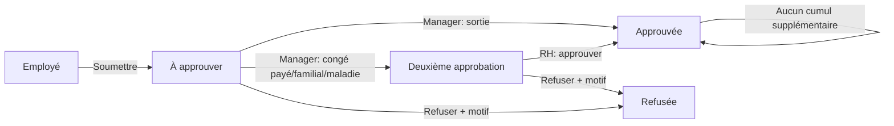
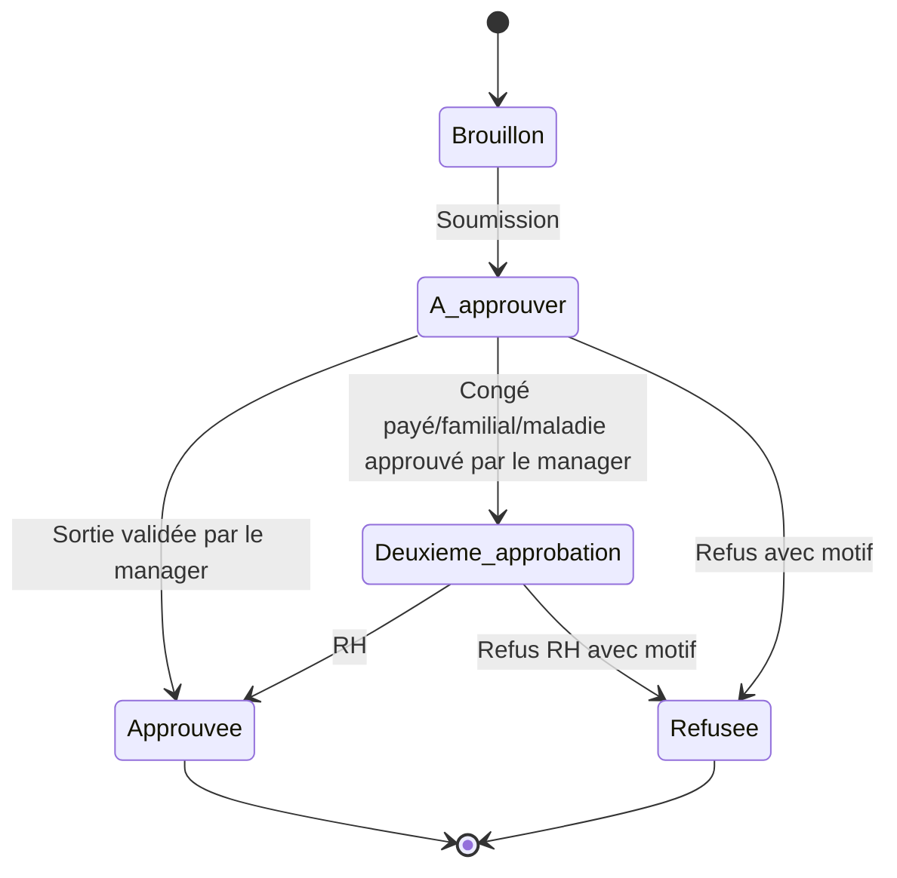

# Partie B — workflow INSEA

## Portée implémentée

Le module étend les demandes `hr.leave` déjà fournies par la Partie A. Il
conserve les types, l’accumulation annuelle de 1,5 jour par mois, le solde
payé, le préavis de sept jours pour plus de trois jours et les durées des
congés familiaux. Les sorties d’au plus quatre heures restent sans effet sur
le solde annuel.

Les autorisations de sortie sont limitées indépendamment à trois demandes
et huit heures cumulées par mois civil. Une justification PDF ou image est
obligatoire avant l’approbation finale médicale. Les chevauchements sont
interdits entre tous les types pour le même employé : brouillons exclus,
demandes soumises, seconde approbation et approuvées incluses. Les plages
adjacentes sont autorisées lorsque la première finit exactement au début de
la seconde.

## Workflow





La maladie d’un jour est conservée dans le circuit double approbation
manager puis RH, conformément au choix retenu par le binôme dans le
handoff. Les types familiaux utilisent également ce circuit double.

## Sécurité

- L’employé voit ses propres demandes et ne peut modifier une demande
  soumise.
- Le manager direct voit et approuve les demandes de son équipe.
- RH avec `hr_holidays.group_hr_holidays_user` voit toutes les demandes.
- L’administrateur garde tous les droits.
- Les pièces jointes utilisent les pièces jointes natives `ir.attachment` ;
  elles restent visibles selon les mêmes règles que la demande.
- Aucun modèle métier personnalisé n’a été créé : `ir.model.access.csv`
  reste inutile pour ce périmètre.

## Tests

Commandes utilisées :

```bash
docker compose run -T --rm odoo odoo -d insea_tests \
  --db-filter='^insea_tests$' \
  -i insea_hr_leave_custom --without-demo=all \
  --test-enable --test-tags=/insea_hr_leave_custom --stop-after-init

docker compose run -T --rm odoo odoo -d insea_tests \
  --db-filter='^insea_tests$' \
  -u insea_hr_leave_custom --without-demo=all \
  --test-enable --test-tags=/insea_hr_leave_custom --stop-after-init
```

Résultat local : **19 tests, 0 échec, 0 erreur** sur
`insea_tests`, après installation puis mise à niveau. Ce lot couvre les
règles historiques de Partie A et les nouvelles règles Partie B.

## Démonstration reproductible

1. Démarrer : `bash scripts/start-odoo.sh`.
2. Installer ou mettre à niveau : commande du guide, sur une base de
   démonstration ou jetable.
3. Créer un employé, lui attribuer un utilisateur et un manager direct.
4. Depuis le compte employé, créer une autorisation de sortie, choisir un
   motif, confirmer, puis vérifier les plafonds mensuels.
5. Depuis le compte manager direct, approuver ou refuser avec motif.
6. Pour un congé payé, vérifier que le manager fait passer la demande à
   `Deuxième approbation`, puis que RH donne l’approbation finale.
7. Joindre un PDF/image pour une sortie médicale avant l’approbation finale.
8. Vérifier qu’un employé ne peut plus modifier une demande confirmée et
   qu’un manager ne voit pas les demandes hors équipe.
